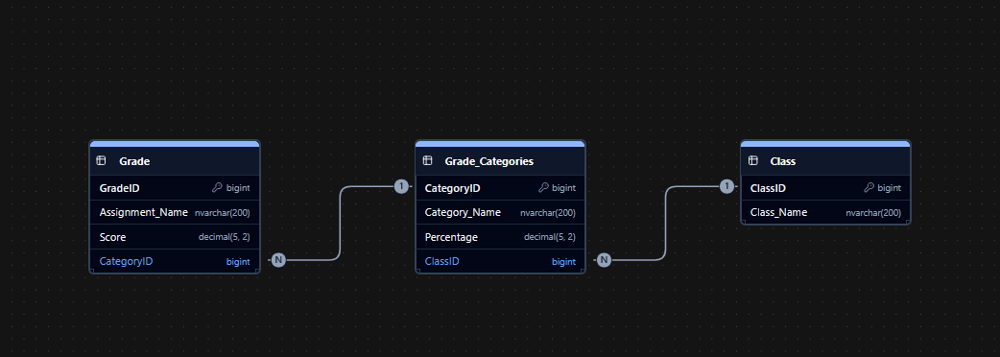

# Grade Calculator

**By:** Vilina Prenko

A desktop grade calculator built with Electron.

## Requirements

- [Node.js](https://nodejs.org/en/download) (latest version recommended). npm is included with it.
- Windows, macOS, or Linux

## Set Up

1. Download all files
2. Install Node.js from the link above.
3. Check that Node and npm work:
   ```
   node -v
   npm -v
   ```
   
4. Open the project folder in your terminal and install the dependencies:
   ```
   npm install
   ```

## Database Setup

The app uses SQL Server running in a Docker container.

1. Install [Docker Desktop](https://www.docker.com/products/docker-desktop/) and make sure it is running.
2. Start the database container:
   ```
   docker run -e "ACCEPT_EULA=Y" -e "MSSQL_SA_PASSWORD=YourPassword" -p 1433:1433 --name sqlserver -d mcr.microsoft.com/mssql/server:2022-latest
   ```
3. Confirm it is running with `docker ps`. You should see `0.0.0.0:1433->1433/tcp`.
4. Set the connection details in `YOUR_CONFIG_FILE`:
   - Server: `localhost,1433`
   - User: `sa`
   - Password: the one you chose in step 2
   - Trust Server Certificate: `true`

Any future use after setting up the container, start the existing container with `docker start sqlserver` instead of step 2.

Here is the structure of the database that was created in ChartDB


## How to Run

1. Open the project folder in your terminal.
2. Start the app:
   ```
   npm start
   ```

